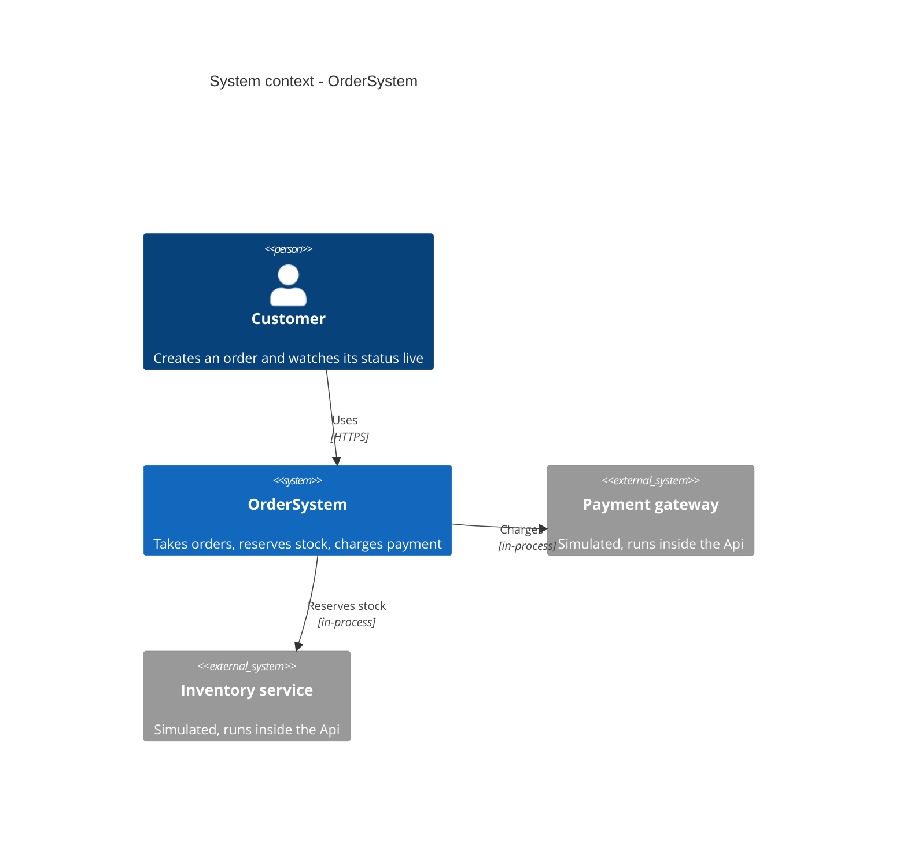
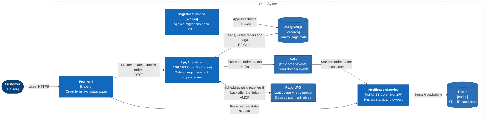
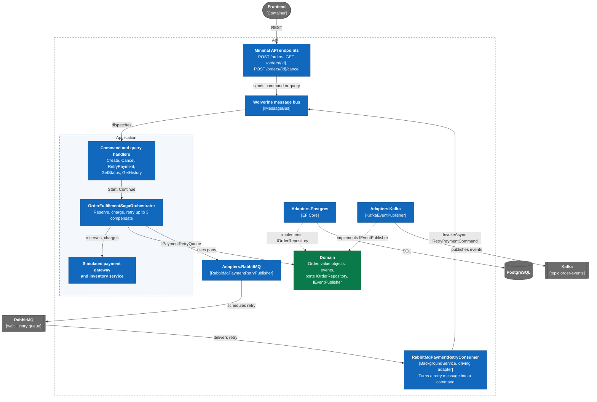
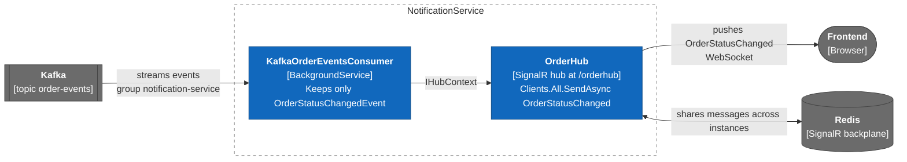
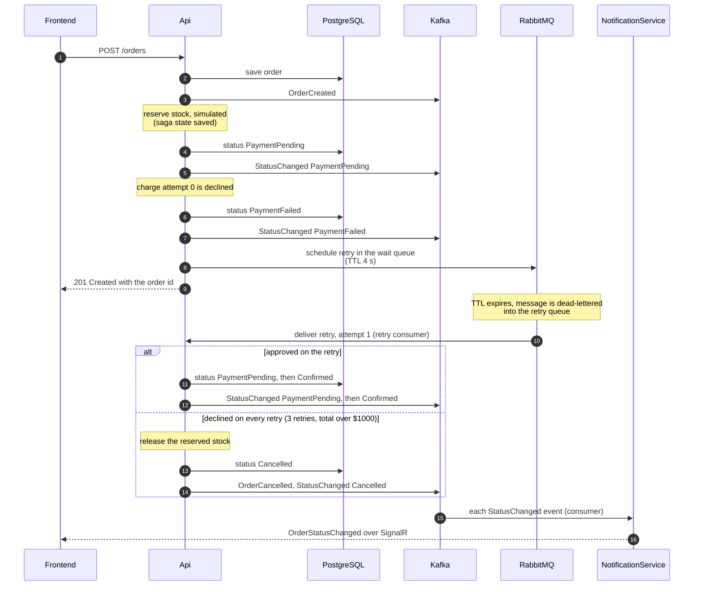

# OrderSystem architecture (C4)

C4 views of OrderSystem, from the whole system down to the parts of its two
services. The README's [Architecture overview](../../README.md#architecture-overview)
explains the *why* behind the hexagonal layering; these views show the *what
talks to what*.

| # | View | Answers |
|---|---|---|
| 1 | [System context](#1-system-context) | Who uses the system, and what does it depend on? |
| 2 | [Containers](#2-containers) | Which deployable pieces exist and how do they talk? |
| 3 | [Api components](#3-api-components) | Where do the saga, the adapters, and the retry consumer live? |
| 4 | [NotificationService components](#4-notificationservice-components) | How does an event reach the browser? |
| 5 | [Order flow with a payment retry](#5-order-flow-with-a-payment-retry) | In what order does it all happen? |

**Reading notes**

- **Replicas** are drawn once, with the count in the label. The Api runs as
  2 replicas behind Aspire's proxy.
- **Payment and inventory are simulated.** `SimulatedPaymentGateway` and
  `SimulatedInventoryService` run inside the Api; they are not separate
  services, and stand in for real external systems.
- **Dev-only tooling is not drawn.** The AppHost also attaches PgWeb, Kafka
  UI, and the RabbitMQ management plugin for local use; they are not part of
  the system's design.
- Diagrams use Mermaid's C4 syntax, which GitHub renders natively. That
  support is experimental, so box placement is automatic and may differ
  slightly between viewers.

---

## 1. System context

A customer creates orders and watches their status. OrderSystem reserves
stock and charges payment; in this project both are simulated.

## 2. Containers

Eight pieces, exactly the resources the Aspire AppHost defines. The Api and
the NotificationService only meet through Kafka. The Api also talks to
itself through RabbitMQ (one two-way arrow): it schedules a delayed retry
there and consumes it back, which is how a declined payment is retried.

> Drawn as a styled flowchart rather than Mermaid's `C4Container` type,
> which overlapped its own labels at this size. Shapes follow C4 notation:
> rounded = person, rectangle = container, cylinder = database, double-bar
> = queue or topic.

## 3. Api components

Inside the Api, solid arrows are calls at runtime and dotted arrows are
"implements a port" (adapter to core), so dependencies point inward. Two
things enter the Api: HTTP requests, and retry messages from RabbitMQ. The
retry consumer is a *driving* adapter like the HTTP endpoints, which is why
the RabbitMQ adapter project references Application (see the README).

> Drawn as a styled flowchart (same reason as the container view).

## 4. NotificationService components

A status change reaches the browser through two components. The consumer
reads the Kafka topic as consumer group `notification-service` and ignores
every event except `OrderStatusChangedEvent` (it checks the `event-type`
message header). The hub then sends it to all connected clients; the
frontend picks out the order it is watching.

> Drawn as a styled flowchart (same reason as the container view).

## 5. Order flow with a payment retry

One order from creation to its final status, for a total between $100 and
$1000: the simulated gateway declines the first charge and approves the
first retry. The `alt` block shows the other ending, a hard decline (total
over $1000). Every status change is saved to PostgreSQL and published to
Kafka; steps 15 and 16 happen for *each* of those events, not just the last.

> Drawn as a sequence diagram instead of Mermaid's `C4Dynamic` type: the
> point of this view is the order of the steps, which a sequence diagram
> shows directly and `C4Dynamic` lays out poorly (same issue as the
> container view).

## Maintaining this document

These views describe the system as it is. They do not update themselves, so
when you change the system, revisit the views in this table in the same
pull request.

| If you change... | Revisit |
|---|---|
| A resource in `hosts/OrderSystem.AppHost/AppHost.cs` (add, remove, rename a container, broker, or store) | 2 Containers, and 1 Context if it is user-facing |
| Which services talk to each other, or over what (new queue, topic, or HTTP call) | 2 Containers, then 3 or 4 for the affected service |
| A consumer, an adapter project, or a port | 3 Api components, or 4 NotificationService components |
| The saga steps, retry count, or retry delay | 5 Order flow (and the "up to 3 retries" wording in 3) |
| What the simulated payment or inventory stands in for | 1 Context |

To check a change, follow `specs/004-add-c4-documentation/quickstart.md`:
render every diagram, compare the container view to the AppHost resource
list, and confirm the consumers shown are the consumers in the code
(`grep -r "class .*Consumer" src hosts`).
